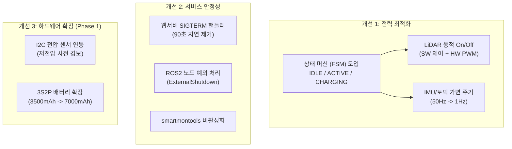

# 💡 스마트 쓰레기통 시스템 개선 제안 리포트 (Improvement Proposal)

- **제안 일자**: 2026-08-16
- **작성자**: Antigravity System Auditor
- **대상 프로젝트**: `smart-trash-bin` (전원 아키텍처, 센서 수명주기, systemd 서비스 안정성)
- **문서 목적**: 3S1P 배터리 전력 소비량 분석 및 최근 시스템 감사 결과를 바탕으로 한 구체적인 소프트웨어/하드웨어 개선 방안과 실행 로드맵 제시

---

## 1. 제안 배경 및 목표

1. **배터리 런타임 제약**: 3S1P(3,500mAh, ~39Wh) 환경에서 모터가 정지해 있어도 LiDAR 회전 및 센서 수집 연산으로 인해 **대기 상태에서도 ~4시간 만에 방전**됨.
2. **동적 전력 관리의 필요성**: 로봇이 방에서 대기할 때 불필요한 센서(LiDAR)와 고빈도 연산을 절전 모드로 전환하여 대기 시간을 70% 이상 연장할 필요가 있음.
3. **프로세스 종료 지연**: systemd 재부팅/종료 시 웹 대시보드의 SIGTERM 미처리로 인한 **90초 정체(SIGKILL 강제종료)** 해소 필요.
4. **저전압 조기 경보 부재**: 배터리 방전 시 사전 감지 없이 급작스러운 리셋이 발생하는 문제를 완화하기 위한 전압 감시 체계 수립 필요.

---

## 2. 세부 개선 제안 과제



---

### [과제 1] 전력 최적화 및 상태 기반 동적 센서 제어

#### 1.1 로봇 동작 상태(FSM) 정의
| 상태 (State) | 진입 조건 | 동작 내용 | 목표 소비전력 |
|---|---|---|---|
| **IDLE (절전 대기)** | 방 안에서 명령 대기 중 | 모터 정지, **LiDAR OFF**, IMU 1Hz 폴링, SLAM 일시중지 | **~5.5 W (대기 6.5~7.0시간)** |
| **ACTIVE (수거/주행)** | 음성/앱 호출 또는 집합 명령 | **LiDAR ON**, IMU 50Hz, SLAM/Nav2 기동, 4WD 모터 구동 | **~25 ~ 35 W (주행 1.0~1.5시간)** |
| **CHARGING (도킹)** | 충전 스테이션 도킹 | LiDAR OFF, Pi 절전, 배터리 충전 모니터링 | **~4.5 W** |

#### 1.2 LD06 LiDAR 동적 제어 구현 방안
- **SW 레벨 (즉시 적용)**:
  - `smart_trash_bringup` 또는 FSM 노드에서 대기 상태 진입 시 LiDAR 노드를 stop/pause하고, 주행 명령 수신 시 start/resume.
  - 고속 시리얼 DMA 인터럽트 및 rclpy 파싱 중단으로 **Pi CPU 연산 전력 약 0.8W~1.0W 절감**.
- **HW 레벨 (물리적 모터/레이저 정지)**:
  - LD06 커넥터의 **PWM 핀**을 Pi 5 GPIO(예: GPIO 18번)에 연결하여 PWM 0% 인가 시 **모터 스핀 및 레이저 발광을 완전히 중단(1.3W 차단)**.

#### 1.3 IMU 및 대시보드 통신 가변 주기 적용
- `imu_publisher_node`에 파라미터 `publish_rate`를 두고 IDLE 시 1Hz로 낮춰 I2C 버스 부하 및 CPU 점유 최소화.
- 웹 대시보드 클라이언트 WebSocket/SSE 폴링 주기를 IDLE 시 1초→5초로 완화.

---

### [과제 2] 프로세스 라이프사이클 및 Graceful Shutdown 보완

#### 2.1 대시보드 웹서버 SIGTERM 핸들러 추가
- **대상 파일**: `tools/motor_dashboard.py`, `tools/sensor_dashboard.py`
- **문제점**: `server.serve_forever()`가 블로킹되어 재부팅 시 90초 대기 후 SIGKILL 강제종료됨.
- **해결 방안**:
  ```python
  import signal
  import threading

  def _sig_handler(signum, frame):
      # serve_forever()를 블로킹 해제하기 위해 별도 스레드에서 shutdown 호출
      threading.Thread(target=server.shutdown, daemon=True).start()

  signal.signal(signal.SIGTERM, _sig_handler)
  signal.signal(signal.SIGINT, _sig_handler)
  ```

#### 2.2 ROS 2 노드 종료 시 예외 핸들링 표준화
- **대상 파일**: `smart_trash_sensors/imu_publisher_node.py`, `tools/map_autosave.py`
- **해결 방안**:
  ```python
  from rclpy.executors import ExternalShutdownException

  try:
      rclpy.spin(node)
  except (KeyboardInterrupt, ExternalShutdownException):
      pass
  finally:
      if rclpy.ok():
          rclpy.shutdown()
  ```

#### 2.3 Failed 서비스 정리
- 불필요한 SMART 데몬 비활성화:
  ```bash
  sudo systemctl disable --now smartmontools
  ```

---

### [과제 3] 배터리 전압 모니터링 및 하드웨어 확장 (Phase 1)

#### 3.1 실시간 배터리 전압 모니터링 노드 도입
- **현상**: Yahboom 모터 보드로는 배터리 전압 조회가 불가능하고 Pi 5 내부 ADC가 없어 급작스러운 저전압 셧다운 위험이 있음.
- **해결 제안**:
  - I2C ADC 모듈(ADS1115) + 전압분배 저항(R1: 30kΩ, R2: 10kΩ) 또는 INA219 모듈을 배터리 XT60 라인에 연결.
  - 전압이 10.5V 이하로 떨어지면 대시보드 알림 및 절전 모드 강제 진입, 10.0V 이하 시 파일시스템 안전 종료(`sudo shutdown -h now`) 수행.

#### 3.2 배터리 팩 용량 확장 (3S1P → 3S2P)
- 18650 3S1P(3,500mAh) → **3S2P (7,000mAh / ~78Wh)** 병렬 확장:
  - **대기 시간**: 약 6.5시간 → **약 14시간** (하루 종일 대기 가능)
  - **주행 시간**: 약 1.2시간 → **약 2.5 ~ 3.0시간** (복수 방 수거 미션 완수 가능)
  - 모터 급가속 시의 전압 강하(Voltage Drop) 및 내부 저항 스트레스 대폭 감소.

---

## 3. 구현 우선순위 및 작업 가이드 (Roadmap for Claude Code)

| 우선순위 | 작업 항목 | 대상 파일 / 명령 | 기대 효과 |
|---|---|---|---|
| 🔴 **P1** | **대시보드 SIGTERM 핸들러 추가** | `tools/motor_dashboard.py`<br/>`tools/sensor_dashboard.py` | 재부팅 시 90초 지연 제거, 즉시 정상 종료 |
| 🔴 **P1** | **ROS 2 노드 종료 예외 처리** | `smart_trash_sensors/imu_publisher_node.py`<br/>`tools/map_autosave.py` | 종료 시 비정상 트레이스백 로그 제거 |
| 🟡 **P2** | **`smartmontools` 서비스 비활성화** | `sudo systemctl disable --now smartmontools` | `systemctl --failed` 클린 유지 |
| 🟡 **P2** | **LiDAR 서비스 동적 제어 스크립트** | `tools/power_control.py` (신규) | 대기 시 LiDAR 정지로 대기시간 70% 연장 |
| 🟢 **P3** | **배터리 전압 I2C 모듈 연동** | 하드웨어 입수 후 `tools/battery_monitor.py` | 저전압 사전 경보 및 안전 셧다운 |
| 🟢 **P3** | **3S2P 배터리 팩 확장** | 하드웨어 작업 (Phase 1) | 실생활용 런타임(대기 14h+) 확보 |
